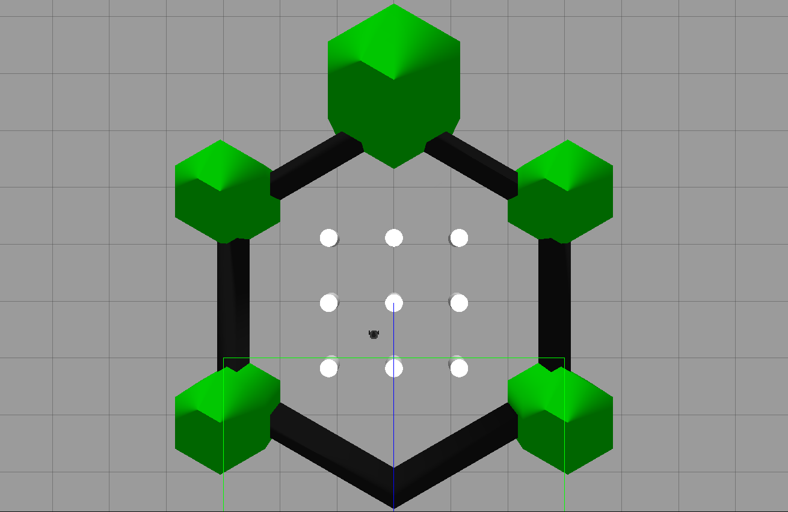
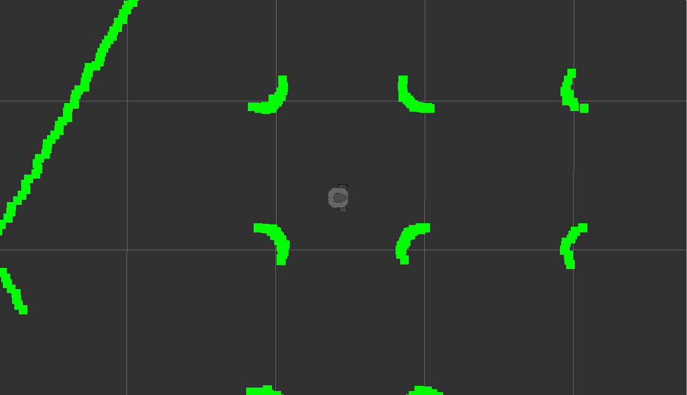
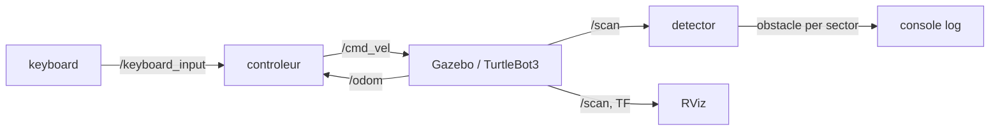
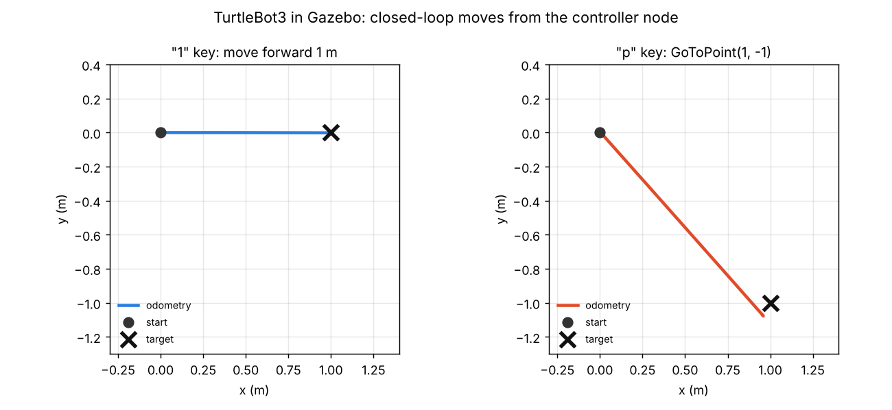

<div align="center">

# 🐢 TurtleBot3 – ROS Control & LiDAR Obstacle Detection

**Keyboard teleoperation, odometry-based closed-loop moves and 360° LiDAR obstacle detection for a TurtleBot3 Burger in Gazebo**


&nbsp;

<sub>Left: the TurtleBot3 world in Gazebo. Right: the live LiDAR scan in RViz, using the project's RViz configuration.</sub>

</div>

> [!NOTE]
> 🇫🇷 **This project was carried out in French.** Code comments, log messages and function names (`avancer` = move forward, `reculer` = move back, `tourner` = turn, `arreter` = stop…) are in French. This README is in English so the project can be read by a wider audience.

---

## 📖 About

Project for the **Robotique mobile et navigation autonome** (*Mobile robotics and autonomous navigation*) course (academic project, September–November 2025), carried out as a **team of two students**.

Starting from a simple velocity publisher, the controller was built step by step:

1. **Teleoperation**: drive the robot with the keyboard.
2. **Odometry-based control**: move an exact distance, rotate an exact angle, reach a point (x, y).
3. **Perception**: detect obstacles around the robot with the 360° LiDAR and visualise the scan in RViz.

## ✨ Features

### 🎮 Keyboard teleoperation
A dedicated `keyboard` node reads key presses in the terminal (raw `termios` input) and publishes their codes on `/keyboard_input`. The `controleur` node subscribes to it and translates them into velocity commands on `/cmd_vel`.

| Key | Action |
|---|---|
| `a` | toggle **auto** / **manual** mode |
| `z` `q` `s` `d` | *manual mode*: forward, turn left, backward, turn right |
| `1` | *auto mode*: drive exactly **1 m** forward |
| `t` | *auto mode*: rotate **45°** |
| `p` | *auto mode*: go to the point **(1, −1)** |
| `r` | publish a reset request on `/reset` |

### 📐 Odometry-based closed-loop moves
The controller subscribes to `/odom`, reads the position (x, y) and converts the orientation quaternion to a yaw angle.
- **`avancer_Continue(d)`**: drives until the Euclidean distance travelled reaches *d*, with a speed proportional to the remaining error.
- **`rotation_Continue(θ)`**: rotates by a signed angle, using an angle-difference function that handles the ±π wrap-around.
- **`GoToPoint(x, y)`**: computes the heading with `atan2`, rotates towards the target, then drives the remaining distance.
- Speeds are **saturated** to the TurtleBot3 Burger limits (0.15 m/s and 2.84 rad/s) so the robot never slips.

### 📡 LiDAR obstacle detection
The `detector` node subscribes to `/scan` (360 samples) and splits it into **8 sectors of 45°**. For each sector it keeps the closest valid return, rejects readings outside the sensor range, and reports an obstacle when it is **closer than 0.5 m**.

## 🧩 ROS architecture



## 🧪 Results in simulation

Measured with the robot's odometry in Gazebo (TurtleBot3 Burger, empty world):

| Command | Target | Result |
|---|---|---|
| `1` – drive forward | 1.00 m | **1.01 m** |
| `t` – rotate | 45° | **43°** |
| `p` – go to point | (1.00, −1.00) | **(0.96, −1.08)** |
| LiDAR detector | closest obstacle per 45° sector | matches the raw `/scan` data |

<div align="center">

</div>

## 🚀 Build & run

Requirements: **ROS Noetic**, the TurtleBot3 packages (`turtlebot3_gazebo`, `turtlebot3_bringup`) and `export TURTLEBOT3_MODEL=burger`.

```bash
cd ~/catkin_ws/src
git clone <this-repository-url>
cd ~/catkin_ws && catkin_make && source devel/setup.bash

# Terminal 1: simulation
roslaunch turtlebot3_gazebo turtlebot3_world.launch

# Terminal 2: controller + keyboard + LiDAR detector
roslaunch tb3_projet run.launch

# Terminal 3 (optional): RViz with the project configuration
roslaunch tb3_projet rviz_tb3.launch
```

The [`scripts/`](scripts) folder contains the helper scripts used during the course: the `cm` build alias (`init.sh`), the simulation launcher and the Gazebo reset.

## 📁 Repository structure

```
turtlebot3-ros-navigation/
├── tb3_projet/                  # catkin package
│   ├── src/
│   │   ├── controleur.cpp       # teleoperation + closed-loop moves
│   │   ├── key_input_node.cpp   # keyboard node
│   │   └── detector.cpp         # LiDAR obstacle detection
│   ├── launch/
│   │   ├── run.launch           # controleur + keyboard + detector
│   │   └── rviz_tb3.launch      # RViz with the TurtleBot3 model
│   └── config/tb3_lidar.rviz
├── scripts/                     # init.sh, run_tb3_simu.sh, reset.sh
└── docs/                        # images used in this README
```

## 🧠 What I learned

- Structuring a robot application in ROS nodes and topics (perception, teleoperation and control kept separate).
- Using odometry for closed-loop control, and why speed saturation matters on a real robot model.
- Handling angles correctly (quaternion to yaw, ±π wrap-around).
- Processing LiDAR data and checking it visually in RViz.
- **Next step:** connect the detector to the controller to obtain true autonomous obstacle avoidance (the auto mode currently runs the predefined moves).

## 🙏 Credits

- Course skeletons, exercises and simulation setup: course instructor.
- [TurtleBot3](https://emanual.robotis.com/docs/en/platform/turtlebot3/overview/) robot and simulation packages by ROBOTIS.
- The screenshots and plots in this README were produced by running this code in Gazebo and RViz.

## 👤 Author

**Sivaharan Kumara Segaram**, embedded systems engineering student. Project carried out with a teammate.
